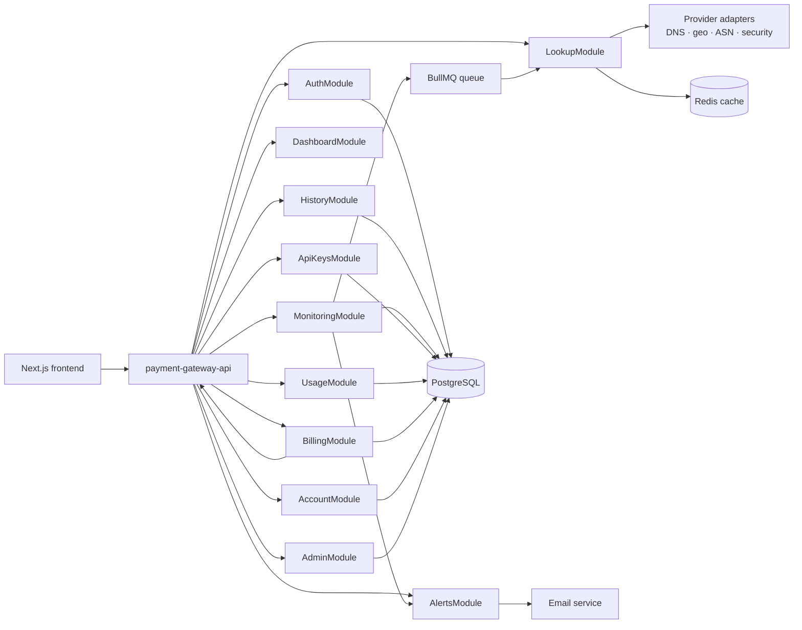
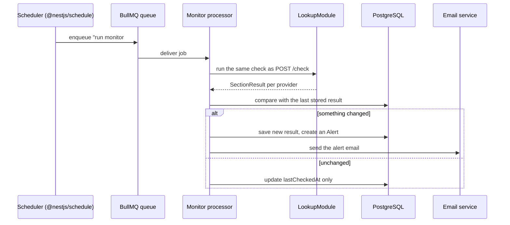

# IPScope Backend — NestJS Build Plan

*Companion to `SAAS_LAUNCH_PLAN.md` (the "why and in what order"). This one is the "how, concretely, in NestJS" — module names, packages, schema, and code shapes, ready to hand to whoever builds it.*

## Status: `ipscope-web` is ready and waiting

Before writing any NestJS code, know that the frontend side of this contract is already built and will not change while `ipscope-api` is developed. Concretely, `ipscope-web` today has:

- **`lib/api/index.ts`** — a client that can send just a few path prefixes to a real backend while everything else stays on the mock (`NEXT_PUBLIC_HTTP_PATHS`), so Phase 1 (auth) can go live for real users before Phase 2–8 exist. No frontend change needed as later phases ship — just widen the prefix list.
- **`proxy.ts`** — redirects a signed-out visitor away from every route in §2's module map before any page JS loads, the moment it sees `NEXT_PUBLIC_API_MODE=http` and no `ipscope_session` cookie. **The cookie must be named exactly `ipscope_session`** — that name is hardcoded on the frontend, not configurable.
- **`.env.example`** and `FRONTEND_CUTOVER_PLAN.md` document every variable (`NEXT_PUBLIC_API_MODE`, `NEXT_PUBLIC_API_BASE_URL`, `NEXT_PUBLIC_HTTP_PATHS`) and the exact CORS/cookie settings (§2 there) `ipscope-api` needs to satisfy from Phase 0 onward.
- A Vitest suite (`npm run test`) covers that routing logic, so a change here would be caught, not just assumed.

Phase 0's first real integration test, as soon as there's a `GET /api/v1/health`: point `ipscope-web` at it with `NEXT_PUBLIC_HTTP_PATHS=/api/v1/health` and confirm the app doesn't need to change.

---

## 1. Two repositories, not a monorepo

This stays poly-repo, matching how everything else is set up: the frontend keeps living in its own repo exactly as it is today, and the backend is a brand new, separate repository.

**`ipscope-web`** (this repo, unchanged) · **`ipscope-api`** (new):

```
ipscope-api/
├── src/
│   ├── main.ts
│   ├── app.module.ts
│   ├── common/
│   │   ├── filters/api-exception.filter.ts
│   │   ├── guards/auth.guard.ts
│   │   ├── guards/plan.guard.ts
│   │   ├── interceptors/quota.interceptor.ts
│   │   └── dto/
│   ├── auth/
│   ├── account/
│   ├── lookup/
│   │   ├── providers/
│   │   │   ├── dns.provider.ts
│   │   │   ├── geo.provider.ts
│   │   │   ├── asn.provider.ts
│   │   │   └── security.provider.ts
│   │   ├── lookup.service.ts
│   │   └── lookup.controller.ts
│   ├── history/
│   ├── dashboard/
│   ├── monitoring/
│   │   ├── monitoring.scheduler.ts   # @nestjs/schedule cron — enqueues jobs
│   │   ├── monitoring.processor.ts   # BullMQ consumer — runs a check, diffs, alerts
│   │   └── monitoring.service.ts
│   ├── alerts/
│   ├── api-keys/
│   ├── usage/
│   ├── billing/
│   │   ├── gateway.client.ts      (payment-gateway-api; Stripe was the first design, see Phase 6)
│   │   └── billing.controller.ts
│   ├── admin/
│   └── db/
│       ├── schema.ts          # pgTable / pgEnum / relations() — see §3
│       └── database.ts        # `Database` type for @InjectDrizzle(); the module itself is @nestjs/drizzle
├── drizzle/
│   └── ...                    # SQL migrations, generated by `drizzle-kit generate`
├── drizzle.config.ts
├── test/
└── docker-compose.yml
```

### Sharing the type contract across two repos

There's no workspace to symlink across, so the `Gated<T>` / `SectionResult<T>` / `ApiErrorCode` shapes need a real boundary. Two ways to do it, in order of how far along the project is:

1. **A small published package — the right long-term answer.** Pull `types/*.ts` out into its own tiny package, `@ipscope/types`, published to a private registry (GitHub Packages is the easiest if the repos already live on GitHub). `ipscope-web` keeps importing from it exactly as it does today; `ipscope-api` adds it as a normal npm dependency and its DTOs import the same types. Bump the version and update both repos whenever the contract changes.
2. **A synced copy — fine to start with.** Copy `types/*.ts` straight into `ipscope-api/src/contracts/` as the starting point for the DTOs each controller validates against, and treat `ipscope-web`'s copy as the source of truth to diff against by hand. No publishing infrastructure needed on day one; switch to option 1 once the contract has stabilized and copy-drift becomes a real risk.

Either way, the payoff over a from-scratch Pydantic model (the FastAPI path) is the same: the shapes are still real TypeScript, not hand-mirrored in a different type system.

---

## 2. Module map



One Nest module per feature area keeps each one testable on its own and mirrors the endpoint groups already defined in `lib/api/endpoints.ts`.

| Endpoint group | Nest module | Controller |
| --- | --- | --- |
| `auth/*` | `AuthModule` | `AuthController` |
| `check`, `check/:id` | `LookupModule` | `LookupController` |
| `history/*` | `HistoryModule` | `HistoryController` |
| `dashboard` | `DashboardModule` | `DashboardController` |
| `plans`, `subscription/*`, `invoices` | `BillingModule` | `BillingController` |
| `usage/*`, `api-usage` | `UsageModule` | `UsageController` |
| `api-keys/*` | `ApiKeysModule` | `ApiKeysController` |
| `monitoring/*` | `MonitoringModule` | `MonitoringController` |
| `alerts/*` | `AlertsModule` | `AlertsController` |
| `account/*` | `AccountModule` | `AccountController` |
| `admin/*` | `AdminModule` | `AdminController` |

---

## 3. Database schema (Drizzle)

The official `@nestjs/drizzle` package (`DrizzleModule.forRoot({ drizzle, connection, schema })` in `app.module.ts`) creates the `pg` pool, closes it on shutdown, and exposes the database to any service via `@InjectDrizzle() private readonly db: Database`. Migrations are generated from `schema.ts` with `drizzle-kit generate` into `./drizzle`, driven by a root `drizzle.config.ts` (`schema: "./src/db/schema.ts"`, `out: "./drizzle"`, `dialect: "postgresql"`, `dbCredentials.url`) and applied with `drizzle-kit migrate`.

```ts
// src/db/schema.ts
import { pgTable, pgEnum, text, boolean, integer, timestamp, jsonb, index } from "drizzle-orm/pg-core";
import { relations } from "drizzle-orm";
import { createId } from "@paralleldrive/cuid2";

export const planEnum = pgEnum("plan", ["free", "pro", "business", "enterprise"]);
export const roleEnum = pgEnum("role", ["user", "admin"]);

export const users = pgTable("users", {
  id: text("id").primaryKey().$defaultFn(() => createId()),
  name: text("name").notNull(),
  email: text("email").notNull().unique(),
  passwordHash: text("password_hash").notNull(),
  plan: planEnum("plan").notNull().default("free"),
  role: roleEnum("role").notNull().default("user"),
  emailVerified: boolean("email_verified").notNull().default(false),
  createdAt: timestamp("created_at").notNull().defaultNow(),
});

export const usersRelations = relations(users, ({ many, one }) => ({
  history: many(historyItems),
  monitors: many(monitors),
  apiKeys: many(apiKeys),
  subscription: one(subscriptions),
}));

export const historyItems = pgTable("history_items", {
  id: text("id").primaryKey().$defaultFn(() => createId()),
  userId: text("user_id").notNull().references(() => users.id),
  target: text("target").notNull(),
  type: text("type").notNull(),
  status: text("status").notNull(),
  checkedAt: timestamp("checked_at").notNull().defaultNow(),
}, (table) => ({
  userCheckedAtIdx: index("history_items_user_id_checked_at_idx").on(table.userId, table.checkedAt),
}));

export const historyItemsRelations = relations(historyItems, ({ one }) => ({
  user: one(users, { fields: [historyItems.userId], references: [users.id] }),
}));

export const monitors = pgTable("monitors", {
  id: text("id").primaryKey().$defaultFn(() => createId()),
  userId: text("user_id").notNull().references(() => users.id),
  target: text("target").notNull(),
  schedule: text("schedule").notNull(),
  status: text("status").notNull(),
  lastResult: jsonb("last_result"),
  lastCheckedAt: timestamp("last_checked_at"),
  nextCheckAt: timestamp("next_check_at"),
});

export const monitorsRelations = relations(monitors, ({ one, many }) => ({
  user: one(users, { fields: [monitors.userId], references: [users.id] }),
  alerts: many(alerts),
}));

export const alerts = pgTable("alerts", {
  id: text("id").primaryKey().$defaultFn(() => createId()),
  monitorId: text("monitor_id").notNull().references(() => monitors.id),
  type: text("type").notNull(),
  severity: text("severity").notNull(),
  read: boolean("read").notNull().default(false),
  createdAt: timestamp("created_at").notNull().defaultNow(),
});

export const alertsRelations = relations(alerts, ({ one }) => ({
  monitor: one(monitors, { fields: [alerts.monitorId], references: [monitors.id] }),
}));

export const apiKeys = pgTable("api_keys", {
  id: text("id").primaryKey().$defaultFn(() => createId()),
  userId: text("user_id").notNull().references(() => users.id),
  prefix: text("prefix").notNull(),
  secretHash: text("secret_hash").notNull(),
  environment: text("environment").notNull(),
  status: text("status").notNull(),
  createdAt: timestamp("created_at").notNull().defaultNow(),
});

export const apiKeysRelations = relations(apiKeys, ({ one }) => ({
  user: one(users, { fields: [apiKeys.userId], references: [users.id] }),
}));

export const subscriptions = pgTable("subscriptions", {
  id: text("id").primaryKey().$defaultFn(() => createId()),
  userId: text("user_id").notNull().unique().references(() => users.id),
  plan: planEnum("plan").notNull(),
  billingCycle: text("billing_cycle").notNull(),
  // As first sketched, with Stripe ids. The built table (src/db/schema.ts) holds a prepaid period instead —
  // current_period_start/end, queued_plan, reminder marks — and `payments` replaced `invoices`. See Phase 6.
});

export const subscriptionsRelations = relations(subscriptions, ({ one, many }) => ({
  user: one(users, { fields: [subscriptions.userId], references: [users.id] }),
  invoices: many(invoices),
}));

export const invoices = pgTable("invoices", {
  id: text("id").primaryKey().$defaultFn(() => createId()),
  subscriptionId: text("subscription_id").notNull().references(() => subscriptions.id),
  number: text("number").notNull(),
  amount: integer("amount").notNull(),
  status: text("status").notNull(),
  issuedAt: timestamp("issued_at").notNull().defaultNow(),
});

export const invoicesRelations = relations(invoices, ({ one }) => ({
  subscription: one(subscriptions, { fields: [invoices.subscriptionId], references: [subscriptions.id] }),
}));
```

Same seven tables and the same `(userId, checkedAt)` composite index as the original design — just plain TypeScript instead of a generated Prisma client, so a service imports `users`/`historyItems`/etc. straight from `schema.ts` and queries with `db.select().from(historyItems).where(...)` (or `db.query.historyItems.findMany({ with: { user: true } })` via the `relations()` calls above), no `prisma generate` step in the build.

---

## 4. Cross-cutting pieces (build these in Phase 0–1, everything else depends on them)

### 4.1 One exception filter, matching `lib/config/errors.ts` exactly

| Code | HTTP | Retryable | Thrown from |
| --- | --- | --- | --- |
| `INVALID_INPUT` | 422 | no | Validation pipe on any DTO |
| `AUTH_REQUIRED` | 401 | no | `AuthGuard` |
| `INVALID_CREDENTIALS` | 401 | no | `AuthService.login` |
| `CONFLICT` | 409 | no | `AuthService.register` (email taken) |
| `FORBIDDEN` | 403 | no | `PlanGuard` / `AdminGuard` |
| `PLAN_REQUIRED` | 403 | no | `PlanGuard` on a gated route |
| `QUOTA_EXCEEDED` | 429 | no | `QuotaInterceptor` |
| `RATE_LIMITED` | 429 | yes | `@nestjs/throttler` |
| `NOT_FOUND` | 404 | no | Any `findOneOrThrow` |
| `DNS_TIMEOUT` | 504 | yes | `DnsProvider` |
| `PROVIDER_UNAVAILABLE` | 503 | yes | Any provider adapter |
| `NETWORK` | 0 | yes | Never thrown server-side — this is the frontend's own "request didn't arrive" case |
| `INTERNAL` | 500 | yes | Global catch-all |

A single `ApiException` class carries a code from this table; `ApiExceptionFilter` (a global `@Catch()` filter) turns it into the exact JSON body `lib/api/errors.ts` expects.

### 4.2 Guards

- **`AuthGuard`** — verifies the session/JWT, attaches `req.user`, throws `AUTH_REQUIRED` if missing. Whatever the session is backed by internally, it must be presented to the browser as a cookie named exactly `ipscope_session` (`HttpOnly`, `Secure`, `SameSite=Lax`) — `ipscope-web`'s `proxy.ts` checks for that cookie by name to redirect signed-out visitors before a protected page's JS loads.
- **`PlanGuard`** — reads a `@RequiresPlan('pro')` decorator on a route, throws `PLAN_REQUIRED` if `req.user.plan` doesn't qualify. This is the server-side half of every `Gated<T>` field: the same guard (or a field-level equivalent inside the service) decides `access: "locked"` vs `access: "included"`.
- **`AdminGuard`** — throws `FORBIDDEN` unless `req.user.role === 'admin'`.

### 4.3 The lookup engine — partial results by construction

```ts
async check(target: NormalizedTarget, viewer: Viewer): Promise<CheckResult> {
  const [dns, geo, asn, security] = await Promise.allSettled([
    this.dnsProvider.resolve(target),
    this.geoProvider.locate(target),
    this.asnProvider.lookup(target),
    this.securityProvider.assess(target),
  ]);

  return {
    dns: toSectionResult(dns),
    geo: toSectionResult(geo),
    asn: toSectionResult(asn),
    security: gate(toSectionResult(security), viewer.plan, 'pro'),
  };
}
```

`toSectionResult` turns a settled/rejected promise into `{ status: "ok", data }` or `{ status: "unavailable" | "timeout", message }` — the exact shape `types/lookup.ts` already defines. Each provider adapter gets its own timeout and its own Redis cache key (`lookup:{provider}:{target}`), so a slow provider degrades to `"timeout"` instead of holding up the other three.

---

## 5. The monitoring loop



`monitoring.scheduler.ts` runs a short, frequent cron (e.g. every minute) that finds monitors whose `nextCheckAt` has passed and enqueues one BullMQ job per monitor — the schedule interval itself lives on the `Monitor` row, not in the cron expression, so every user's custom interval works off one shared cron.

---

## 6. Build order, with the packages each phase adds

### Phase 0 — Foundations
- Create the `ipscope-api` repository, `nest new .` inside it, start `@ipscope/types` (or copy `types/*.ts` in as a first pass — see §1).
- `npm i @nestjs/config @nestjs/swagger class-validator class-transformer`
- `docker-compose.yml`: `api`, `postgres`, `redis`.
- **Exit:** `GET /api/v1/health` returns `200` locally and in staging.

### Phase 1 — Auth & account
- Modules: `AuthModule`, `AccountModule`, `CommonModule` (filter + guards).
- Built with DB-backed sessions instead of passport/JWT/bcrypt: an opaque token in the `ipscope_session` cookie (only its SHA-256 is stored in `sessions`) gives instant revocation for logout, the sessions list, password reset and Phase 7 suspension; passwords use Node's built-in scrypt (no native build step). Packages added: `cookie-parser`, `nodemailer`, `@nestjs/throttler`.
- Contract additions not in `lib/api/endpoints.ts` yet — add them here, backend and frontend together, not before: `POST /auth/forgot-password`, `POST /auth/reset-password`, `POST /auth/resend-verification`, `GET /auth/verify-email`.
- **Done (2026-09-24)** — paired frontend work for this phase, previously dead `href="#"` links / no page at all: a forgot-password form, a reset-password form (token from the emailed link), a "Resend verification email" action in Settings, and a `/verify-email` landing page.
- **Exit:** `NEXT_PUBLIC_API_MODE=http` in staging; login/signup/settings/password-reset/email-verification all work against a real account.

### Phase 2 — Lookup engine
- Module: `LookupModule` + provider adapters + Redis caching.
- `npm i ioredis @nestjs/cache-manager cache-manager`
- Pick and wire the real DNS/geo/ASN/security providers (see `SAAS_LAUNCH_PLAN.md` §5).
- **Built (2026-09-24), with these choices:** DNS over HTTPS (Cloudflare, then Google) instead of the OS resolver, for real TTLs and rcodes; geolocation and ASN from the `@ip-location-db/dbip-city-mmdb` and `@ip-location-db/asn-mmdb` packages read with `maxmind` (no keys, offline); security from AbuseIPDB (needs `ABUSEIPDB_API_KEY`); `ioredis` directly instead of `@nestjs/cache-manager`, with an in-memory fallback; quotas in Postgres (`usage_counters`, atomic upsert) rather than Redis counters, so they're durable and exact. The whole result is cached ungated and entitlements are applied on the way out. Force a provider to fail with `LOOKUP_FORCE_FAIL=security`.
- **Exit:** a real lookup renders correctly with one provider forced to fail in staging.

### Phase 3 — History, dashboard, usage
- Modules: `HistoryModule`, `DashboardModule`, `UsageModule`.
- **Built (2026-09-24), with these choices:** `GET /history` (search, type, range, sort and paging in SQL, every order ending on `id` so pages never repeat a row), `DELETE /history/:id`, `DELETE /history`; `GET /dashboard`; `GET /usage`, `GET /usage/quota` (public, for visitors) and `GET /usage/analytics` (Pro). Analytics come from a new `lookup_events` table (status, cache hit, duration, per-provider latency; no target is stored) rather than from history, so cache hits and failed lookups count too, with each figure compared against the previous period of the same length and days bucketed in UTC. "Most checked targets" comes from `history_items`. A cache hit costs no quota but is still filed in the viewer's history, as a copy under its own id (the cache is shared by everyone, so the original id belongs to whoever ran it first). The response carries the copy's id so it reopens through `GET /check/:id`, and the row is dated when the user looked while the report inside keeps its own data time (`cache.ageSeconds` says how old it is). A user who already has that report isn't given a second row for every repeat; their existing row's id is returned.
- **Not built here, on purpose:** `GET /api-usage` and the API-requests figure need API keys, so both wait for Phase 5 (the tile shows 0 until then); `recentAlerts` on the dashboard is an empty list until Phase 4 creates alerts; `GET /history/:id` isn't needed because the frontend reopens a saved check through `GET /check/:id`. Pruning old `lookup_events` and orphaned `usage_counters` rows belongs to Phase 8.
- **Exit:** history and usage persist across devices.

### Phase 4 — Monitoring & alerts
- Modules: `MonitoringModule`, `AlertsModule`.
- `npm i @nestjs/schedule @nestjs/bullmq bullmq`, plus an email SDK (Resend/Postmark).
- **Built (2026-09-24), with these choices:**
  - **No BullMQ and no `@nestjs/schedule`.** The scheduler is a plain `setInterval` in the API process; each monitor keeps its own `nextCheckAt`, and a tick takes the due ones with `SELECT … FOR UPDATE SKIP LOCKED` and pushes their `nextCheckAt` three minutes ahead in the same transaction (a lease). Several API instances can share the database and never run a monitor twice; if an instance dies mid-run the lease lapses and another picks the monitor up. It needs no Redis, which is optional everywhere else. Email is nodemailer over SMTP (Resend/Postmark/SES all offer SMTP) instead of a vendor SDK.
  - **Routes:** `GET/POST /monitoring`, `PATCH /monitoring/:id` (pause/resume), `POST /monitoring/:id/run`, `DELETE /monitoring/:id`; `GET /alerts`, `PATCH /alerts/:id`, `POST /alerts/read-all`. Both modules are Pro-gated (`403 PLAN_REQUIRED`). Creating a monitor runs it once at once, which records the baseline; at the plan's limit it answers `PLAN_REQUIRED` naming the next plan up (count and insert run under a per-user advisory lock, so simultaneous creates can't slip past the limit); the same target twice is `CONFLICT`. Intervals are the five the site offers (5 min, 15 min, 1 h, 6 h, 1 day).
  - **What a run does** (`MonitorRunner`): looks at the target with `LookupService.inspect` (full Pro data, no quota, no history, no analytics event; DNS always live, the security reading may come from the cache to protect the AbuseIPDB budget), digests it into a small snapshot (`snapshot.ts`, TTLs left out because resolvers count them down), and diffs it with the last good snapshot (`diff.ts`) for the kinds of change the monitor watches. The first look is only a baseline. A change must be seen twice, `MONITORING_CONFIRM_DELAY_MS` apart, before it alerts. A look that can't read the target (timeout, providers down, SERVFAIL) is a failure, not a change: it leaves the baseline alone, retries within five minutes, and three in a row mark the monitor failing with one `monitor_failed` alert; the next good look recovers it. Parts a provider couldn't deliver this time (MX/NS/TXT/SOA, a reputation reading, a network owner) are carried over from the previous snapshot instead of being read as removed.
  - **Alerts** belong to the user, not the monitor (`alerts.user_id`; `monitor_id` is `ON DELETE SET NULL` and the target is copied onto the row), because the monitoring page promises "existing alerts stay in your inbox". One alert per kind of change per run. `paused` and `changed` are derived on read from `enabled` and from unread change alerts, not stored, so marking alerts read settles "changed" with nothing to keep in sync.
  - **Email:** one message per run, to verified addresses only, only medium severity and up, honouring the two switches in Settings (monitor alerts, security alerts), and at most one per monitor every 30 minutes (critical skips the wait). A mail outage is logged and never fails a run.
  - A downgrade below Pro stops the scheduler from running that user's monitors and locks the routes and the dashboard numbers, without deleting anything.
  - **Also fixed here:** the pool now pins the session time zone to UTC (`options: '-c timezone=UTC'`), because `now()` defaults were being written in the server's local time while Drizzle reads the columns as UTC — every default-stamped column (`alerts.created_at`, `users.created_at`, …) read back hours off on a machine that isn't on UTC.
  - Migrations `0004`/`0005` reshape `monitors` and `alerts` (both were still empty).
- **Verified live:** a real lookup baselines a monitor; the stored baseline was edited to differ from the current DNS (a real domain's records can't be changed from here), and the next real run produced the alerts and one real email, captured by a local SMTP sink; scheduler claims verified across two independent connection pools; failure, recovery, pause/resume, downgrade and delete behaviour verified against the API and in the browser. AbuseIPDB-driven security alerts are unverified (no key yet).
- **Exit:** a real DNS change on a test domain produces a real email.

### Phase 5 — API & API keys
- Module: `ApiKeysModule`; a bearer-token variant of `AuthGuard` for API callers.
- `npm i @nestjs/throttler`
- **Built (2026-09-26), with these choices:**
  - **Routes:** `GET/POST /api-keys`, `POST /api-keys/:id/revoke`, `DELETE /api-keys/:id`, `GET /api-usage` (all cookie-authenticated and Pro-gated), and `POST /check` now also accepts `Authorization: Bearer ips_live_…`. Keys are `ips_live_` / `ips_test_` + 43 random base64url characters; only their SHA-256 and a 13-character display prefix are stored, and the secret is returned once at creation. An account holds at most 25 keys (count and insert run under a per-user advisory lock).
  - **A key can only call `POST /check`.** `AuthGuard` looks at a bearer token only on routes marked `@AllowApiKey()`; everywhere else it is ignored, so a key can never list, mint or revoke keys or touch the account, history, monitors or billing. On a marked route a bearer token means the caller chose key authentication: a missing, malformed, unknown or revoked key is `401` (never a quiet fall-back to anonymous), an owner who has dropped below Pro is `403 PLAN_REQUIRED`, and nothing is cached, so a revoked key stops on its very next request. A key whose shape is wrong never reaches the database, and wrong keys are counted per IP (30 a minute) to bound guessing.
  - **Metering.** Every key request counts against the monthly API allowance (`usage_counters` key `api:<user>:<YYYY-MM>`, atomic like the web quota; Pro 150,000, Business 2,000,000, Enterprise capped at 1,000,000 until billing defines "custom"), cache hits included; only a request that got nothing back is refunded. It is separate from the web lookup quota, is not saved to history, and is logged in `lookup_events` with `source = 'api'`, which is what the API tile in usage analytics and the API dashboard's series read. Concurrent identical requests share one provider run but every caller is charged. `quota` in the response describes the API allowance.
  - **Rate limits.** Per key, one-minute fixed window counted in the shared cache (Redis, in-process fallback): 1,000 a minute for a production key (5,000 on Business and above), 100 for a development key. The limit is worked out from the owner's plan when it is applied, not stored, so an upgrade reaches existing keys. Responses carry `X-RateLimit-Limit/Remaining/Reset`; a refusal is `429 RATE_LIMITED` with `Retry-After` and `details.retryAfterSeconds`. The per-IP throttle (20 a minute on `/check`) is skipped for key requests. A fixed window can let through up to twice the limit across a boundary; a sliding window is a Phase 8 candidate.
  - **`lastUsedAt`** is rewritten at most once a minute per key, so a busy key is not a database write per request.
  - **Frontend docs fixed:** the docs page and code samples said the response had a top-level `ips` (`const { ips } = …`); the real body is `{ result, quota, savedToHistory }` (the API dashboard already said "Read `result.ips`"). The samples, the example response and the limits text now match.
  - Migration `0006` adds `name`, `last_used_at`, `revoked_at`, a unique index on the hash and a `(user, created_at)` index to `api_keys`.
- **Verified live:** the full lifecycle against real Postgres and real DNS (create, list, use with `curl` and no cookie, revoke, delete, validation, ownership, the 25-key cap, downgrade and upgrade), the per-minute limit (exactly 100 of 121 accepted, the rest 429 with `Retry-After`, and refused requests not counted), the monthly quota (last request allowed, next `QUOTA_EXCEEDED`, twelve simultaneous requests at one remaining let exactly one through), a failed request refunded and shown in the error rate, and no secret in the database row or the server log. The rate limit was shared between two API instances through Redis (100 accepted in total, not 100 each, with a 2-window TTL on the counter). This last check used a small Redis-protocol server with the real `ioredis` client rather than Redis itself (Docker was off). In the browser: create (secret shown once), list with "last used", the API dashboard's real numbers, revoke (the next `curl` is `401`), delete.
- **Exit:** a `curl` request with a live key returns the documented JSON shape.

### Phase 6 — Billing
- Module: `BillingModule`. **No Stripe SDK.** Payments go through `payment-gateway-api`, the shared gateway `proxy-backend` already uses (a separate GraphQL service in front of BTCPay/Lightning, CoinGate and Stripe; the gateway's administrator decides which the customer sees). The first version of this phase was built against Stripe Subscriptions and then replaced (2026-09-26) at the owner's direction; everything Stripe-specific was deleted, migration `0010` dropped its tables and columns.
- **Built (2026-09-26), prepaid periods:**
  - **The model.** The gateway takes one-off invoices only — no subscriptions, no saved cards, no proration, no customer portal. So a customer buys a *period* of a plan (30 days at the monthly price, 365 at the annual one) and **nothing renews by itself**: when the period ends the account moves to Free unless they paid again. `users.plan` (what limits are enforced from) follows the period; `subscriptions` holds what has been paid for; `payments` holds every invoice asked of the gateway and is also the billing history.
  - **Pure rules (`billing-rules.ts`).** `quoteChange` says what a choice costs: a *purchase* (nothing running) or *renewal* (same plan again) is the full price, the renewal added after the current period; an *upgrade* (bigger plan, or monthly → annual) is the new price less credit for the unused days of what was paid, and starts at once for a fresh period; a *queue* (smaller plan, or annual → monthly) is bought now at full price, starts when the current period ends, and nothing is refunded. `applyPayment` gives a paid payment its effect from what the user has **now**, not what they had when they clicked (same plan → extend, bigger → switch, smaller → queue), so a late or doubled payment can't double-grant; `roll` starts the queued plan or ends the period. Credit is proportional to time left and never more than was paid; the minimum charge is $1.
  - **Routes:** `GET /plans` (public), `GET/POST /subscription`, `GET /subscription/quote` (works with billing off), `POST /subscription/refresh`, `GET /subscription/invoices`, `POST /webhooks/gateway`. Cookie-only; an API key can't reach billing. `POST /subscription` opens a gateway invoice for exactly the quoted amount and answers with its `checkoutUrl`; asking again for the same thing returns the same open invoice; at most three unpaid invoices may be open; Free opens nothing; Enterprise is contact-sales (`409`).
  - **Finding out about payments.** Two paths into one transaction. (1) A background poller (`BillingScheduler` → `BillingJobs.pollDue`, every 20 s, five payments a pass to respect the gateway's ~20 requests a minute from one address; each payment backs off 15 s → 30 s → 60 s → 2 min → 5 min, and is given up on ten minutes past its expiry) — always enough on its own. (2) The gateway's signed webhook (`X-Gateway-Signature`, hex HMAC-SHA256 of the raw body, `PAYMENT_GATEWAY_WEBHOOK_SECRET`, optional) — a message only says *which invoice*; we then ask the gateway what it looks like and act on that, so a forged, replayed or reordered message can't change anything. `/subscription/refresh` asks about the caller's open invoices immediately; the billing page calls it on return from paying.
  - **Exactly once.** `BillingStore.settle` locks the payment row, checks `applied_at`, refuses a paid amount that differs from what we asked (marked failed, logged for a person), and grants the period and sets `applied_at` in one transaction. Verified with ten simultaneous refreshes and webhooks: one grant, thirty days, one event.
  - **Lapsing and reminders.** Every tick, periods that ended roll on (queued plan starts, or back to Free), `SKIP LOCKED` so several instances can run it; every five minutes reminders go out a week and a day before the end (once per period, re-armed by a renewal; not when the next plan is already paid for) and one note after a plan ends (only for expiries in the last three days). A receipt goes out when a payment lands. All to verified addresses only.
  - **Refunds** are noticed only through the webhook (a paid invoice stops being polled): a refunded payment ends the plan it bought. Without a webhook secret refunds need handling by hand.
  - **Ships dark:** billing is on only when `PAYMENT_GATEWAY_URL`, `PAYMENT_GATEWAY_SLUG` and the `PAYMENT_GATEWAY_API_KEY_ID/SECRET` pair are all set; off, the routes answer `503` and everyone keeps their plan. The URL must be `https://` (plain http only for localhost); an unknown gateway status is treated as still pending, never as paid.
  - **Contract (`types/account.ts`, copied to `src/contracts/`):** `Subscription` lost `nextBillingDate`, `cancelAtPeriodEnd` and `paymentMethod` and gained `renewalDue`, `queued`, `pendingPayment`; new `PlanQuote`, `PendingPayment`, `QueuedPlan`; `PortalSession` and `PaymentMethod` are gone. `ipscope-web`: the change-plan dialog fetches and shows the quote before anything opens, every paid choice ends at the gateway's checkout, the billing page shows "Finish your payment", "Renew" (last 7 days) and "starts on …" notices, the card block and cancel section are gone, and the return trip (`?checkout=success`) tells whether the payment actually took effect by comparing the plan before and after (another invoice may still be open).
  - Migrations `0009` (payments, queued-plan and reminder columns) and `0010` (drops the Stripe tables and columns).
- **Verified:** 670 backend and 131 frontend unit tests (rules, gateway client with mocked HTTP, service, store-facing jobs, scheduler, mail). Live against real Postgres, the running API (two instances on one database) and a **fake gateway** speaking the same GraphQL surface (`live-gateway.js`, 84 checks): purchase → checkout URL → invoice open → paid → plan and limits change (`/monitoring` 403 → 200), quote-then-charge equals the quoted amount, renewal, upgrade with credit, a plan bought in advance starting by itself at period end, lapse to Free by the scheduler, ten-way concurrency granting once, the webhook (valid, wrong secret, unsigned, wrong link, replay, unknown invoice), amount mismatch, expired and cancelled invoices, refund, reminders and expiry notes with real queries, three instances rolling one expired row at once, Enterprise, the open-invoice cap. In the browser against that stack: quote text, redirect to checkout, return and toast, "Finish your payment", the upgrade credit, "Renew".
- **Not verified — needs a real merchant at the gateway:** the real `payment-gateway-api`. Its administrator must create an IPScope merchant, payment link (the slug) and API key pair — *not* `proxy-backend`'s `dice-proxy` credentials, which would mix the two products' money. The GraphQL shapes (`createInvoice`, `invoice`) come from `proxy-backend`'s working adapter, but nothing here has spoken to the real service; the first real run should check the invoice fields, that the checkout URL returns to `/billing?checkout=success`, the gateway's rate limit against the poll rate, and whether its webhook is live yet.
- **Exit:** paying for Pro actually changes the enforced limits. *(Verified end to end against a fake gateway; the "real gateway" half waits for the merchant.)*

### Phase 7 — Admin & abuse
- Modules: `AdminModule` (guarded by `AdminGuard`, cookie-only) and `AbuseModule`.
- **Built (2026-09-26), with these choices:**
  - **Suspension is enforced everywhere at once.** `users.suspended_at` / `suspension_reason`. Suspending deletes the user's sessions (their next cookie request is `401`), and a session that somehow survives is still refused (`SessionService.findActive` excludes suspended owners); API keys answer `403 FORBIDDEN` on the very next call (checked per request, like revocation); signing in is `403` — but only after the password checked out, so a wrong password stays "incorrect" and nothing leaks to a stranger; monitors stop being claimed. Data and billing are left alone. Administrators can't be suspended (`409`); repeating is harmless. Every admin action is written to `audit_log` (actor's email copied in, so the trail survives a deletion).
  - **Routes:** `GET /admin/overview`, `GET /admin/users` (search by name/email with `%` and `_` treated as text, status filter, paging), `POST /admin/users/:id/suspend|reactivate`, `POST /admin/abuse/:id/block|dismiss|reopen`. Administrators are made from the server: `npm run admin:grant -- email` / `admin:revoke` (there is no API for it).
  - **The overview is real data.** Totals with deltas against the period before (0 when there is nothing to compare with — never an invented trend), MRR (the monthly value of paid plans running now at their one-period price; prepaid, so not "recurring"), the plan mix, 30 days of lookups by source (signed-out counts come from the daily quota counters, so they exclude cache hits), the most recently active users (`lastActiveAt` = latest of session activity, last lookup, sign-up; `checks30d` real), recent subscription events (`subscription_events`, written by billing when a payment changes a plan, renews one, fails, or a period ends), provider health measured from the last 15 minutes of real provider calls **on this instance** (`ProviderHealthService` fed by `ProviderRunner`; the AbuseIPDB provider is reported *down, with the reason* when it has no key), and six infrastructure cards measured, not asserted (API uptime/memory, Postgres latency and connection use, cache mode, monitoring backlog, email, billing). The contract's invented `circuit` (there is no circuit breaker) became `calls` and an optional `detail`.
  - **Abuse detection.** Three signals, counted in the shared cache and only written to `abuse_flags` when a count passes a bar in `abuse-rules.ts`, so a typo costs nothing: lookups of internal/reserved targets (an account or a hashed network: 10 an hour to flag, 25 medium, 60 high), an anonymous visitor who keeps asking after the daily limit (20 in a day), and an API key that keeps sending requests over its per-minute limit (100 refusals in an hour). One row per (kind, subject, reason); the count only rises within a flag; a dismissed flag reopens by itself only if the behaviour doubles. Networks are hashes, never IPs: a flag reads `net:9f2c1a…41ab`.
  - **Blocking is real.** Block on an account flag suspends it, on a key flag revokes the key, on a network flag refuses that network's anonymous lookups (`403`, checked with a 15-second in-process cache; signed-in users on that network are unaffected). Reopen lifts an account or network block; a revoked key can't be restored (`409`, its owner makes a new one). Blocking an administrator is refused.
  - Migration `0008` (suspension columns, `subscription_events`, `abuse_flags`, `blocked_visitors`, `audit_log`). `ipscope-web`: the Users and Abuse panels now call the API (server-side search, suspend/reactivate, block/dismiss/reopen) instead of editing local state; the providers table shows calls and the reason instead of a circuit breaker.
- **Verified:** live against real Postgres and two API instances (`live-admin.js`, 99 checks): access (401/403 and the CLI), the overview's figures against the database, search and paging, the exit criterion (a suspended user's cookie, API key and login refused on the very next request; monitors unclaimed; reactivation restores all of it; audit rows), each abuse signal raising a flag at its bar and not before, severity rising on the same row, block/reopen/dismiss for accounts, networks and keys with the real effect on the next request, and no raw IP in any flag or block-list row. Two real bugs were found this way and fixed: correlated subqueries that named the outer column bare (drizzle leaves single-table columns unqualified, so `lastActiveAt` and `checks30d` were silently wrong, and so was the "plan that ended" lookup for expiry emails), and MRR counting a stacked renewal's whole payment as one month. In the browser: the real overview, suspending a user from the menu, the abuse table and Block.
- **Deliberately not built:** reading the audit log through the API (rows are there for SQL), an admin view of a user's whole account, promoting admins over HTTP. Abuse counters are per-cache: with several instances and no Redis each counts on its own and flags later. The daily-limit signal needs an anonymous visitor to keep hammering; a determined one behind many networks isn't caught by any of these.
- **Exit:** suspending a user in the admin view blocks their very next request. *(Verified: cookie `401`, API key `403`, sign-in `403`, monitors stopped.)*

### Phase 8 — Hardening & launch
- **Built (2026-09-26), with these choices:**
  - **Packages:** `helmet`, `compression`, `nestjs-pino` (+ `pino`, `pino-http`; `pino-pretty` as a dev dependency), `@sentry/node`.
  - **Headers and compression** (`main.ts`): strict helmet for the API (`default-src 'none'`, `frame-ancestors 'none'`, `nosniff`, HSTS, `Cross-Origin-Resource-Policy: cross-origin` so the web app can still read responses CORS allows); `/docs` and `/docs-json` alone are served without a content policy so Swagger UI works. gzip on every response (the OpenAPI document goes from 74 KB to 13 KB).
  - **Logging** (`src/observability/logging.config.ts`): pino via `nestjs-pino`, also carrying Nest's own `Logger` (start-up lines are buffered until it is ready). JSON in production, `pino-pretty` elsewhere; `LOG_LEVEL`. A request line holds the method and path only — no query string (it can carry a token or an email), no socket address (visitors are only ever known by a keyed hash) — and `cookie`, `authorization`, `x-gateway-signature` and `set-cookie` are redacted whatever the level. Status 4xx logs as warn, 5xx as error; the health routes are not logged. Start-up colour codes are dropped in production.
  - **Error reporting** (`src/observability/sentry.ts`): ships dark, on only when `SENTRY_DSN` is set. Reports unexpected exceptions and 5xx from `ApiExceptionFilter`; `dataCollection` turns off user info, cookies, headers, bodies and query strings, and `scrubEvent` is a backstop. (`sendDefaultPii` no longer exists in v11.)
  - **Housekeeping** (`src/maintenance/`): a job in the API process every six hours (first run a minute after boot; `MAINTENANCE_ENABLED=false` to turn off) deletes, in batches of 5,000: sessions and email links expired more than a day ago, `lookup_events` older than 200 days (`LOOKUP_EVENT_RETENTION_DAYS`; analytics reach back 90 days plus the 90 they are compared with), anonymous `usage_counters` older than 70 days (the admin chart needs 60), per-account monthly counters older than 400 days, alerts older than 365 days (`ALERT_RETENTION_DAYS`). It never touches saved checks, monitors, API keys, subscriptions, payments or the audit log. Unset, zero or junk settings fall back to the defaults.
  - **Health:** `GET /health` stays liveness; new `GET /health/ready` answers 503 when Postgres is unreachable (for load balancers and the Docker `HEALTHCHECK`). Boot warns in production when `TRUST_PROXY` or `CORS_ALLOWED_ORIGINS` is unset.
  - **Swagger:** the audit found 52 operations, all tagged, 51 with a summary and every one with a 2xx schema; added the missing summary, and replaced the description (it pointed at this plan file) with authentication, error shape and limits, and a correct `bearerFormat` (was `JWT`).
  - **Docker:** new `.dockerignore` (`COPY . .` used to bake `.env.local` into the build stage), `USER node`, `HEALTHCHECK` on `/health/ready`. README has a new "Deploying" section.
  - **Security review** (by reading the code, not a penetration test): scrypt (N=2^15, r=8, p=3) for passwords; sessions, API keys, email links stored as hashes only; webhook signature checked with `timingSafeEqual`; body size is Express's 100 KB default; DTOs whitelist and reject unknown fields; the only outbound fetches go to fixed hosts (DNS-over-HTTPS, the reputation service, the Tor list, the payment gateway) and monitors reuse the lookup pipeline, so there is no user-supplied-URL fetch to abuse; cookie is `HttpOnly`, `SameSite=Lax`, `Secure` in production; CORS is an explicit list. **Accepted, not changed:** routes for signed-in users that read only their own rows (history, alerts, dashboard, usage) have no per-IP throttle of their own — behind an office NAT a shared 60-a-minute allowance would lock out real users, and abuse would need an account; the per-key rate limit is a fixed one-minute window (up to twice the limit across a boundary, capped by the monthly allowance) — a sliding window would also need a smarter `Retry-After`, and was not worth the risk to a working limiter.
  - **Paired frontend:** `/terms` and `/privacy` (`app/(marketing)/`, content in `components/legal/`, facts and contacts in `lib/config/legal.ts`); the signup form's links point at them (new tab, so a half-filled form isn't lost) and the footer lists both.
- **Verified:** `npm test` 736 tests, lint and `tsc` clean; frontend 137 tests, `tsc`, `eslint` clean. Live, against a production-mode instance on the real dev database: security headers and gzip on the API, `/docs` without the content policy, log lines checked for a planted cookie, bearer token and query token (none present), Sentry switched on with a dummy DSN and off without one, `/health/ready`, the housekeeping SQL (rows created at each side of every cutoff: old ones deleted, recent and grace-period ones kept, second run finds nothing, test rows removed), the per-key limit (100/minute development key: 99+1 accepted, 31 of 130 refused with `Retry-After`). Load test of `POST /check` with a Business API key on one machine, single process, no Redis: 909 req/s served from cache (p50 21 ms, p95 30 ms, p99 39 ms, no errors); with distinct public IPs the API runs at the pace of its upstream DNS lookups (p50 about 0.6 s, p95 3 s = the provider timeout) and scales with concurrency (20 → 100 connections: 20 → 97 req/s), no 5xx, RSS about 265 MB afterwards. The new pages were rendered in a real Next dev server (desktop and 390 px wide).
- **Not verified / for whoever goes live:** Sentry against a real project (needs a DSN); the Docker image (`HEALTHCHECK`, `USER node`) was not built here; Redis-backed behaviour under load; the legal text needs a lawyer's review and the operator's real entity, contact addresses and jurisdiction — the addresses (`privacy@ipscope.dev`, `support@ipscope.dev`), the 30-day answer time and the refund on termination without breach are placeholders for business decisions; payment (needs IPScope's own merchant at the gateway, see Phase 6).
- **Exit:** go live. *(Code-side ready. The remaining items above are decisions and credentials, not code.)*

### Phase 9 — Bulk lookup
- **Built (2026-09-27), with these choices:**
  - **Not a BullMQ queue.** Like monitoring and billing, a job runs in the API process: `BulkScheduler` ticks every 3s, `BulkStore.claimJob` takes the batch that has waited longest under a `SKIP LOCKED` row lock and a lease (`leased_until`), so any number of instances share the work and a crashed instance's batch is picked up again where it stopped — verified live by killing an instance mid-batch. A batch gets a worker for up to 20s (`SLICE_MS`) at a time before yielding to another waiting one.
  - **A line is an ordinary lookup.** `BulkRunner` calls the same `LookupService.check` a single `POST /check` uses — same cache, same monthly quota (a cache hit is free, a fresh line costs one lookup, a line that gets nothing back is refunded), same entitlements — with `skipHistory: true` (new on `Viewer`) so a batch of hundreds doesn't flood the account's history page. Five lines run at once (`CONCURRENCY`).
  - **Lines, not just the batch, have state.** `bulk_items` (composite PK `(job_id, position)`) holds a summary per line — addresses, location, ASN, connection type, risk score/level, VPN/proxy/Tor/datacenter — not the full report; reopening one target's full result is a normal lookup. `prepareEntries` (pure, in `bulk-rules.ts`) drops blanks, dedupes after normalizing, and keeps a bad line as `invalid` with its reason instead of shrinking the batch silently.
  - **Running out of quota mid-batch stops it cleanly.** `stoppedReason: 'quota'` (the month ran out) or `'plan'` (checked fresh from the database each run — a downgrade mid-batch is honored, not just at submission); every line still `pending` is marked `skipped` with why, so nothing is left hanging.
  - **Limits:** batch size follows the plan's `bulkBatchSize` (Pro 100, Business 1,000, Enterprise negotiated — capped at `BULK_HARD_CAP` 10,000 regardless); two batches may be queued or running per account at once (409 CONFLICT beyond that, checked in the same request that creates one). Deleting a batch — finished or not — removes it and its lines (`ON DELETE CASCADE`); deleting one still running is how a batch is cancelled (lines already charged stay charged).
  - **Housekeeping:** `bulk_jobs` older than 30 days is pruned (`BULK_RETENTION_DAYS`), same batches-of-5,000 loop as the rest of `MaintenanceService`.
  - **Routes:** `GET /bulk` (the caller's batches + the plan's batch size and open-job limit), `POST /bulk`, `GET /bulk/:id` (paged lines, `offset`/`limit` up to 500), `DELETE /bulk/:id`. `BULK_SCHEDULER_ENABLED=false` to turn the worker off on an instance. Migration `0011`.
  - **Frontend** (`ipchecker-web`): new contract `types/bulk.ts`; `/bulk` (list + a textarea-based "New batch" dialog showing a live target count against the plan's limit) and `/bulk/[id]` (progress bar, a line-by-line table with status and signal chips, CSV/JSON export gated the same as History's, paging); a sidebar entry gated on the `bulkLookup` feature that already existed. The mock backend reproduces the same line handling and paces a batch against the wall clock instead of a real worker — deterministic and reload-safe, since progress is computed from elapsed time on every read rather than a background timer (documented in `lib/mock/handlers/bulk.ts`); its `PLAN_REQUIRED` stop-reason branch is real code but effectively unreachable through the mock's request-gated routes, same as the real controller's guard would make it for a signed-in owner.
- **Verified:** `npm test` 776 (up from 736) backend tests, lint and `tsc` clean; frontend 151 (up from 137) tests, `tsc`, `eslint` clean. Live, two real API instances sharing the real dev database (43 checks): plan gate (free 403, signed-out 401), validation (empty/blank targets, plan's batch-size limit, unknown fields), dedupe and invalid-line handling, charging (fresh line costs one lookup, a repeat from cache is free, invalid lines are free), lines never reach history, pagination, ownership (another Pro account's batch is 404; a Free account gets 403 before it even reaches the ownership check, same as any other bulk route), the two-open-job limit and 409, deleting a running batch cancels it and its lines are gone, the month running out mid-batch (stops, skips the rest, quota counter never overshoots), a suspended owner's batch is left alone until reactivated, and — killing the instance holding a batch mid-run — the other instance finishes it with no line run twice. Browser: signed in as Pro, a batch of 7 lines (1 duplicate, 1 invalid domain, 1 private IP) ran to completion, the sidebar's monthly count rose by exactly the lines that were charged, the completed batch never touched Recent checks/History, CSV/JSON export, delete with its confirm dialog, desktop and 390px-wide layouts.
- **Not verified:** a batch anywhere near `BULK_HARD_CAP`; the Enterprise "negotiated" batch size (there is no Enterprise account to test against).
- **Exit:** submit a batch, watch it complete, read back every line's result. *(Verified above.)*

### Phase 10 — Team workspace
- **Built (2026-09-27), with these choices:**
  - **Seat-based plan sharing, not literal data sharing.** The original pitch ("share history, monitors and API keys across your organization") was never scoped further than that one line. Built instead: a Business+ owner creates a team and invites existing IPScope accounts by email; once an invited account accepts, it runs under the *owner's plan's* features and quota limits, under its own account — its own history, monitors, API keys and billing stay completely separate. Leaving or being removed reverts the account to its own plan immediately. Nothing is pooled or shared; only entitlement is.
  - **One field carries the elevation.** `User` gained a required `effectivePlan` (`plan` stays what's actually paid for, shown in billing; `effectivePlan` is that, or a team owner's plan if higher). `toUser()` defaults it honestly to `row.plan`; `tierOf()` (`common/features.ts`) was the one place changed to read `effectivePlan` instead of `plan`, which cascades correctly through `canAccess()` and every lookup-result gate for free. Enrichment happens only where something is actually decided: `AuthGuard` for both the session and API-key paths (live requests), and `MonitorRunner`/`BulkRunner` explicitly re-checking via `TeamsService.effectivePlan()` on every run (not cached from job-creation time — a downgrade or a removal mid-schedule takes effect on the very next run).
  - **`TeamsService.effectivePlan(user)`** looks up an active membership → the owner → the owner's plan, elevates only if higher (never down), cached 15s in-process (same pattern as `AbuseService.isBlocked`), invalidated immediately on accept/remove/leave for the affected account.
  - **Business rules:** one team per owner; a user can be invited to or a member of at most one team ever (leaving/removal deletes the row so they're free to join elsewhere later); can't invite someone who owns their own team or is already invited/active elsewhere; seat limit (`teamSeats` — Business 10, Enterprise unlimited, Free/Pro 0) counts invited *and* active seats against the cap; an invite target must already have an IPScope account — nothing is held for an unregistered email.
  - **Monitor scheduling decoupled from plan at claim time.** `MonitorStore.claimDue` no longer pre-filters by the owner's plan — it claims every enabled, due, non-suspended monitor; `MonitorRunner` now checks entitlement fresh right before running and, if the owner no longer qualifies (own plan or team both insufficient), calls the new `MonitorStore.postpone()` to push `next_check_at` forward without touching `status`, `consecutiveFailures` or `lastCheckedAt` — a lapsed entitlement is never recorded as a failure.
  - **Deliberately not elevated (v1 boundary):** an API key's per-minute rate limit, and every billing/subscription view (`billing.service.ts` untouched) — both always reflect the account's own real plan.
  - **Frontend:** `/team` (not feature-gated as a page — any signed-in account may view its own team-or-membership state; only *creating* a team checks the plan, shown inline via the existing `UpgradeWall`), `/team/accept?token=…` (mirrors `VerifyEmailStatus`'s pattern). Actions that change the *caller's own* `effectivePlan` (accept, leave) call `useSession().refresh()` so the sidebar and every feature gate update live, not just the team page's own data — owner-initiated actions (remove, delete) don't need this since an owner's own plan never changes.
  - **Migration** `0012_team_workspace.sql`: `teams`, `team_members` tables, `'team_invite'` added to the existing auth-token-type enum (invite links reuse the same token/email infrastructure as password reset and email verification).
- **Verified:** `npm test` 824 backend tests, lint and `tsc` clean; frontend 170 tests, lint and `tsc` clean. Live, two real API instances sharing the real dev database (46 checks): create/rename/delete, seat limits, invite validation (self-invite, no-such-account, already-on-a-team, already-owns-a-team), accept only by the invited account (a wrong account's attempt is refused *without* burning the token — the real invite still works afterwards), elevation actually reaching a `@RequiresPlan` route, a monitor owned by a since-downgraded/removed member quietly rescheduling instead of counting as a failure, a bulk batch owned by an elevated Free account still running mid-job, leave/remove reverting the plan immediately, 0 leftover rows after cleanup. Browser (mock mode, isolated instance): create team, invite, wrong-account accept refused, correct accept elevates live (plan badge + unlocked sidebar), leave reverts live, mobile 390px layout, delete team back to the empty state.
- **Not verified:** the sidebar's monthly-lookup counter is fed by a separate, non-session-tied fetch (`dashboardService.getSummary()` in the sidebar, not remounted on navigation) — after leaving a team the plan badge updates immediately but that one number stays stale until a full reload. Pre-existing to how the app caches that call, not specific to teams; not fixed here.
- **Exit:** invite a teammate, they accept, they get the plan's features and limits, they leave or get removed, they're back on their own. *(Verified above.)*

---

## 7. Local development

```yaml
# docker-compose.yml (in the ipscope-api repo)
services:
  api:
    build: .
    env_file: .env
    ports: ["4000:4000"]
    depends_on: [postgres, redis]
  postgres:
    image: postgres:16
    environment:
      POSTGRES_PASSWORD: ipscope
    ports: ["5432:5432"]
  redis:
    image: redis:7
    ports: ["6379:6379"]
```

Frontend side, unchanged files, just the two env vars from `SAAS_LAUNCH_PLAN.md` §1:

```
NEXT_PUBLIC_API_MODE=http
NEXT_PUBLIC_API_BASE_URL=http://localhost:4000
```

---

## 8. Testing

- **Unit:** Jest, one spec per service — the lookup service's `Promise.allSettled` branch (one provider rejecting) is the single most important test in the whole backend.
- **e2e:** Nest's `@nestjs/testing` + `supertest`, one spec per controller, asserting the exact `ApiErrorCode` on every failure path.
- **Contract:** since DTOs import from `@ipscope/types` (or the synced copy), a type error at build time is the first line of contract testing — CI running `tsc --noEmit` on `ipscope-api` catches drift immediately.
