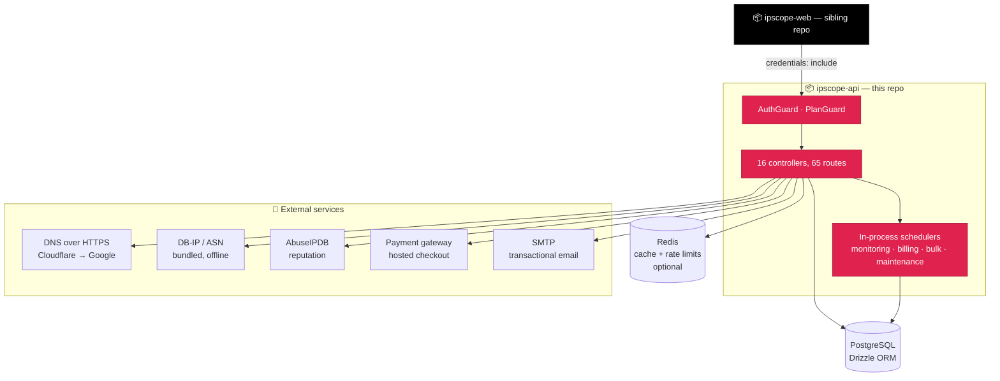

<div align="center">

# 🔍 IPScope — API

**NestJS backend for IPScope.** Real DNS, geolocation and network-ownership lookups, a real
database, real accounts — the companion `ipscope-web` frontend talks to this over REST.

[](https://nestjs.com)
[](https://www.typescriptlang.org)
[](https://www.postgresql.org)
[](https://redis.io)
[](https://jestjs.io)
[](#current-scope)

</div>

---

Poly-repo, not a monorepo — this folder is its own project (own `package.json`, own `git init`
when work starts here), just kept next to `ipchecker-frontend` (the `ipscope-web` repo) on disk
for convenience.

## Contents

- [Overview](#overview)
- [Architecture](#architecture)
- [Features](#features)
- [Stack — in detail](#stack)
- [Getting started](#getting-started)
- [Testing](#testing)
- [Deploying](#deploying)
- [Project structure](#project-structure)
- [Scripts](#scripts)
- [Challenges solved along the way](#challenges-solved-along-the-way)
- [Current scope](#current-scope)
- [Future scope](#future-scope)

<a id="overview"></a>

## Overview

| | |
|---|---|
| ⚙️ Runtime | NestJS 12, TypeScript 6, CommonJS (Node 24's `require(esm)` loads the ESM-only Nest packages) |
| 🗄️ Database | PostgreSQL + Drizzle ORM — schema in `src/db/schema.ts`, migrations in `./drizzle` |
| 🔐 Auth | HttpOnly `ipscope_session` cookie, or a bearer API key (`ips_live_…`) for programmatic calls |
| 🌐 Data sources | DNS over HTTPS (Cloudflare → Google), DB-IP + ASN (bundled, offline), AbuseIPDB reputation |
| ⚡ Cache & limits | Redis when present, silent in-process fallback when it's not (§[Stack](#stack)) |
| 💳 Billing | Prepaid periods through a shared payment gateway — no subscriptions, no saved cards |
| 📄 Docs | Swagger UI at `/docs`, raw spec at `/docs-json` — 65 operations, all tagged and schema'd |

See `NESTJS_BACKEND_PLAN.md` for the module map, Drizzle schema, and the full phase-by-phase build
log (exact dates, choices, what was verified). **All 10 planned phases are built.** What's left
isn't code — see [Future scope](#future-scope).

<a id="architecture"></a>

## 🏗️ Architecture



No queue, no BullMQ. Every background job (monitoring, billing, bulk, maintenance) runs a
`setInterval` scheduler inside the API process itself and claims its work in Postgres with
`FOR UPDATE SKIP LOCKED` — any number of instances can share one database without doing the same
job twice, and nothing extra needs to be deployed or kept alive.

<a id="features"></a>

## ✨ Features

| Area | Routes | What it does |
|---|---|---|
| 🔎 Lookup | `/check` | Real DNS, geolocation, ASN/network and reputation signals, partial results when one provider is down |
| 👤 Auth & account | `/auth`, `/account` | Register, login, sessions, password reset, email verification, profile, notifications |
| 📜 History & dashboard | `/history`, `/dashboard`, `/usage` | Searchable saved checks, usage summary, quota meter, usage analytics on Pro |
| 📡 Monitoring & alerts | `/monitoring`, `/alerts` | Scheduled re-checks, diffed against the last good look, turned into alerts + email |
| 🔑 API & keys | `/api-keys`, `/api-usage` | Bearer-token access, its own per-key rate limit, usage dashboard |
| 📦 Bulk lookup | `/bulk` | A batch of targets as one job — same cache, quota and charging as a single check |
| 👥 Teams | `/team` | Business+ seat sharing — invited accounts run on the owner's plan; their own data stays separate |
| 💳 Billing | `/plans`, `/subscription`, `/webhooks/gateway` | Quoted price, hosted checkout, prepaid periods, found by poller + signed webhook |
| 🛡️ Admin | `/admin` | Platform overview, user search, suspension, abuse review (dismiss / block / reopen) |

> Every gated route is enforced server-side by `PlanGuard` — the frontend hiding a locked feature
> is UX, never the actual boundary.

<a id="stack"></a>

## 🧱 Stack — in detail

- NestJS 12 (CommonJS project; the v12 packages are ESM-only and load through Node 24's `require(esm)`), TypeScript 6, REST controllers (not GraphQL) — `ipscope-web` expects exact `{ error: { code, message } }` JSON shapes and `ApiErrorCode`s, see `NESTJS_BACKEND_PLAN.md` §4.1
- Drizzle ORM (0.45) + PostgreSQL (not TypeORM/Prisma) via the official `@nestjs/drizzle` module — schema lives in `src/db/schema.ts`, migrations generated with `drizzle-kit` into `./drizzle`. Services get the database with `@InjectDrizzle() private readonly db: Database` (type in `src/db/database.ts`)
- class-validator + class-transformer for DTO validation; Swagger docs at `/docs` (raw spec at `/docs-json`)
- Sessions: an opaque random token in the `ipscope_session` cookie (HttpOnly, SameSite=Lax by default); only its SHA-256 lives in the `sessions` table, so any session can be revoked instantly. Passwords use Node's built-in scrypt.
- Lookup providers (behind adapters, each with its own timeout and cache key): DNS over HTTPS with Cloudflare then Google as fallback (real TTLs and NXDOMAIN/SERVFAIL); geolocation from DB-IP Lite and IP-to-ASN data, both bundled as npm packages and read from memory (no key, no per-lookup cost) — also reused for the Sessions list's "last seen from" location; security (reputation, VPN/proxy/Tor) from AbuseIPDB when `ABUSEIPDB_API_KEY` is set, otherwise that one section reports "unavailable"
- Redis (`ioredis`) caches provider answers and whole results and holds the per-key rate-limit counters, so the limit is shared across API instances; if it's absent or down the API silently uses an in-process cache (and each instance then counts on its own, which loosens a limit rather than blocking anyone)
- Email via nodemailer/SMTP (logs to the console when `SMTP_HOST` is unset); per-IP rate limiting on the auth routes (10/min), password changes (5/min), key creation (10/min) and `POST /check` (20/min) via `@nestjs/throttler`; requests made with an API key are limited per key instead (1,000/min production, 5,000 on Business and above, 100 for a development key)
- Monitoring, billing, bulk and maintenance each run their own `setInterval` scheduler in the API process; due work is claimed in Postgres with `FOR UPDATE SKIP LOCKED`, so any number of instances share one database without a queue or Redis. Switch any one off per instance: `MONITORING_ENABLED=false`, `BILLING_SCHEDULER_ENABLED=false`, `BULK_SCHEDULER_ENABLED=false`, `MAINTENANCE_ENABLED=false`.
- Billing goes through `payment-gateway-api` (one-off invoices, a hosted checkout per invoice; no subscriptions and no saved cards, so plans are prepaid periods that don't renew by themselves). It ships dark: on only when `PAYMENT_GATEWAY_URL`, `PAYMENT_GATEWAY_SLUG` and the `PAYMENT_GATEWAY_API_KEY_ID/SECRET` pair are all set (off, the billing routes answer `503` and everyone keeps their plan). The gateway's administrator must create an IPScope merchant, payment link and API key first. Payments are found by a background poller and, optionally, by the gateway's signed webhook; a plan is granted exactly once.
- Teams (`/team`): a Business+ account invites existing accounts onto its plan's features and quota limits — `User.effectivePlan` is the one field every gate reads, enriched fresh on every request and every background job run, never cached from invite time. No history, monitors, API keys or billing are ever shared.
- Administrators are made from the server (`npm run admin:grant -- email`), never over HTTP. Suspending a user deletes their sessions and refuses their API keys and sign-in on the next request; abuse signals are counted in the shared cache and only become flags past a threshold.
- Every `429` says how long to wait: the per-IP throttle answers `RATE_LIMITED` with `details.retryAfterSeconds` in the body and a `Retry-After` header (an API key's per-minute limit does the same, plus `X-RateLimit-*`). CORS exposes `Retry-After` and `X-RateLimit-*` to the web app (`src/config/cors.config.ts`), which a browser on another origin can't read otherwise. A monthly `QUOTA_EXCEEDED` deliberately carries no `Retry-After`: it reopens at `details.resetsAt`, not "in a moment".
- The database session time zone is pinned to UTC on every connection (see `databaseConnection`), so `now()` defaults and Drizzle's timestamp reading agree on any machine.

<a id="getting-started"></a>

## 🚀 Getting started

**Prerequisites:** Node.js 24+ (the NestJS 12 packages are ESM-only and load through Node 24's
`require(esm)`) and Docker (for a disposable Postgres/Redis — or point at your own, see below).

```bash
git clone <this repo's URL> ip-backend
cd ip-backend
npm install

cp .env.example .env.local             # then open it — see below for what to fill in
docker compose up -d postgres redis    # a fresh, empty Postgres + Redis, mapped to the ports .env.example already has

npm run db:migrate                     # applies every migration in ./drizzle — creates all tables, no data
npm run start:dev                      # watch mode
```

> ⚠️ **Don't skip `npm run db:migrate`.** The API boots and `/health` answers fine without it —
> the boot check is only `select 1`, not a table check — but every real route (register, login,
> a lookup) will fail with a database error until it's run. It applies every migration already in
> `./drizzle` (creates all 19 tables, no data). Re-run it any time after pulling new migration
> files; it only applies what's missing.

**Check it's alive:**

| | |
|---|---|
| 🩺 Health check | [`http://localhost:4000/api/v1/health`](http://localhost:4000/api/v1/health) → `{ "status": "ok", "database": "ok" }` |
| 📄 Swagger UI | [`http://localhost:4000/docs`](http://localhost:4000/docs) — every route, request/response shape, `ApiErrorCode`; call routes straight from the page |
| 🧾 Raw OpenAPI spec | [`http://localhost:4000/docs-json`](http://localhost:4000/docs-json) |

From there, register through the frontend (or `POST /api/v1/auth/register` directly) to get a
first account — no seed data ships with the repo.

**Filling in `.env.local`:** most values in `.env.example` already work as-is against the
`docker compose` Postgres/Redis above and need no change for local dev. Two you should set
yourself even locally:

| Variable | What to put |
|---|---|
| `IP_HASH_SECRET` | Any long random string, e.g. `openssl rand -hex 32` (PowerShell has no `openssl` — use `node -e "console.log(require('crypto').randomBytes(32).toString('hex'))"` instead). Also required in production. |
| `APP_WEB_URL` | Where `ipchecker-frontend` runs (`http://localhost:3000` by default) — emailed links (verify email, reset password, team invite) point here. |

Everything else in `.env.example` is optional for local dev and documented inline: without
`SMTP_HOST` emails print to the console instead of sending, without `ABUSEIPDB_API_KEY` the
security section of a lookup reports "unavailable", without the four `PAYMENT_GATEWAY_*` values
billing answers `503` and everyone keeps their plan, without `REDIS_HOST` the API falls back to an
in-process cache. `npm run db:generate` is only needed after editing `src/db/schema.ts` yourself —
the migrations already in `./drizzle` cover everything currently built.

**Already have a Postgres/Redis running some other way** (native install, a different Docker
setup, WSL)? Skip `docker compose up` and point `DATABASE_URL`/`DB_*` and
`REDIS_HOST`/`REDIS_PORT` in `.env.local` at them instead — nothing else changes. If a *native*
Postgres already owns port 5432 on your machine, don't fight it for the port: give the
`docker compose` one a different host port in `docker-compose.yml`'s `ports:` line (it's already
off the default for exactly this reason — see the comment there) and update `.env.local` to
match.

**Frontend:** `ipchecker-frontend` is a separate repo. Point it at this API with
`NEXT_PUBLIC_API_MODE=http` and `NEXT_PUBLIC_API_BASE_URL=http://localhost:4000` in its own
`.env.local` — see that repo's README.

<a id="testing"></a>

## 🧪 Testing

```bash
npm run test          # Jest unit tests
npm run test:watch
npm run test:cov
npm run test:e2e
npm run lint
npx tsc --noEmit -p tsconfig.build.json
```

One spec per service; the lookup service's `Promise.allSettled` branch (one provider rejecting,
the rest still returning) is the single most important test in the whole backend. `npm run test`
sets `--experimental-vm-modules`, which Jest needs to load the ESM-only NestJS 12 packages.

<a id="deploying"></a>

## ☁️ Deploying

**This API deploys to a VPS or a container host — not Vercel.** It's a long-running process with
in-process background schedulers (monitoring, billing, bulk, maintenance) and a persistent
database connection; Vercel runs serverless functions with a request time limit, not that. Any
host that can run a Node process works: a plain VPS, Docker Compose, Fly.io, Railway, a
Kubernetes cluster. **`ipchecker-frontend` is the repo that deploys to Vercel** — see its own
README for that.

- **Build and run:** `npm ci && npm run build`, then `NODE_ENV=production node dist/main` with a `.env.prod` in the working directory (or real environment variables). The Dockerfile does the same, runs as the unprivileged `node` user and has a `HEALTHCHECK` on `/api/v1/health/ready`.
- **Migrations are not run on start.** Run `npm run db:migrate` (against the production `DATABASE_URL`) as a deploy step before the new version takes traffic.
- **Behind a proxy or load balancer, set `TRUST_PROXY`** to the number of proxy hops (usually `1`). Without it every visitor shares the proxy's address, so the 2-a-day limit, per-IP throttles and abuse counters act on everyone at once (the API warns at boot in production). Set it only when a proxy you control really sits in front: otherwise a visitor can forge `X-Forwarded-For`.

### Environment variables for production

Put these in `.env.prod` (read automatically when `NODE_ENV=production`) or set as real
environment variables on the host — never commit either.

**Required — the API is broken or insecure without these:**

| Variable | What it's for |
|---|---|
| `NODE_ENV=production` | Switches the env-file loader to `.env.prod`, turns on `secure` cookies, JSON logs, and the boot-time warnings below |
| `DATABASE_URL` | Postgres connection string (takes precedence over the individual `DB_*` fields) |
| `CORS_ALLOWED_ORIGINS` | The exact origin(s) of your deployed frontend, comma-separated — never `*` (cookie auth needs `credentials: true`) |
| `IP_HASH_SECRET` | Any long random string (`openssl rand -hex 32`) — keys the hash that identifies anonymous visitors for the 2-a-day limit |
| `APP_WEB_URL` | Where the frontend lives — emailed links (verify email, reset password, team invite) point here |
| `TRUST_PROXY` | Hop count to your load balancer/reverse proxy (usually `1`) — without it every visitor shares the proxy's address and rate limits/quotas act on everyone at once |

**Strongly advised — the API runs without these, but noticeably worse:**

| Variable | Without it |
|---|---|
| `REDIS_HOST` (or `REDIS_URL`) | Falls back to an in-process cache — fine for one instance, loosens rate limits across several |
| `SMTP_HOST`, `SMTP_PORT`, `SMTP_USER`, `SMTP_PASSWORD`, `MAIL_FROM` | Emails (verify, reset, alerts, invites) only print to the log instead of sending |
| `ABUSEIPDB_API_KEY` | A lookup's security section always reports "unavailable" |
| `COOKIE_DOMAIN` (e.g. `.yourdomain.com`) | Fine if frontend and backend share a parent domain and you don't set it; required if the cookie needs to reach a sibling subdomain like `api.` |

**Optional, feature-gated — the relevant feature just ships off:**

| Variable | Feature |
|---|---|
| `PAYMENT_GATEWAY_URL`, `PAYMENT_GATEWAY_SLUG`, `PAYMENT_GATEWAY_API_KEY_ID`, `PAYMENT_GATEWAY_API_KEY_SECRET` (all four) | Billing — without all four, billing routes answer `503` and everyone keeps their plan |
| `PAYMENT_GATEWAY_WEBHOOK_SECRET` | Instant payment confirmation via webhook — without it, a background poller still finds every payment, just up to 15s slower |
| `SENTRY_DSN` (+ `SENTRY_ENVIRONMENT`, `SENTRY_RELEASE`) | Error reporting — nothing is sent anywhere until this is set |
| `MONITORING_ENABLED`, `BILLING_SCHEDULER_ENABLED`, `BULK_SCHEDULER_ENABLED`, `MAINTENANCE_ENABLED` | Set any to `false` on an instance that should only serve requests, not run that background job (see "Several instances" below) |
| `LOG_LEVEL` | Verbosity — defaults to `info` in production |

**Never set in production:** `LOOKUP_FORCE_FAIL` (a staging switch to force providers to fail) and
`COOKIE_CROSS_SITE` (weakens the session cookie to `SameSite=None` — meant for cross-domain
testing only; the API warns at boot if it's left on).

- **Keep frontend and backend on the same parent domain** (`app.yourdomain.com` + `api.yourdomain.com`) so the session cookie stays a same-site, first-party cookie with `COOKIE_DOMAIN=.yourdomain.com` — the sturdier default (`SameSite=Lax`). Two genuinely unrelated domains (e.g. two separate tunnel subdomains while demoing) need `COOKIE_CROSS_SITE=true` (opt-in, never tied to `NODE_ENV`), which sets `SameSite=None; Secure` for real cross-site traffic over HTTPS — weaker CSRF protection, not recommended for production, and the API warns at boot if it's left on there.
- **Several instances:** every background job (monitoring, billing, bulk, maintenance) claims its work safely, so any number of instances can share one database. Turn a scheduler off with `MONITORING_ENABLED=false`, `BILLING_SCHEDULER_ENABLED=false`, `BULK_SCHEDULER_ENABLED=false` or `MAINTENANCE_ENABLED=false` on instances that should only serve, and keep each on for at least one.
- **Load balancer probes:** use `/api/v1/health/ready` (503 when the database is unreachable); `/api/v1/health` is liveness and always answers while the process is up. Neither is logged.
- **Response headers:** `helmet` sets a strict policy for the API (`default-src 'none'`, no framing, `nosniff`, HSTS) and answers cross-origin reads, which CORS still decides; `/docs` alone is served without a content policy so the Swagger UI can run. Responses are gzip-compressed.
- **Logs and errors:** JSON lines on stdout in production (pino). Set `SENTRY_DSN` to report unexpected 5xx failures; nothing is sent otherwise.
- **Known limits:** the per-key rate limit is a fixed one-minute window, so a client can briefly send up to twice its limit across a window boundary (the monthly allowance still caps it). The optional `/docs` page is public.

<a id="project-structure"></a>

## 📂 Project structure

```text
src/
  config/        env.config.ts (.env.local / .env.prod loader), database.config.ts (connection options + startup check), cors.config.ts (origins, exposed headers)
  db/            schema.ts (Drizzle tables), database.ts (injected `Database` type), errors.ts
  common/
    decorators/  @Public, @RequiresPlan, @CurrentUser / @RequiredUser / @CurrentSessionId, @ApiErrorResponses
    dto/         api-exception.ts (ApiErrorCode, ApiException), shared Swagger DTOs
    filters/     api-exception.filter.ts (global exception -> JSON body)
    guards/      auth.guard.ts (global), plan.guard.ts, admin.guard.ts
    validators/  shared email / password / name rules (mirror ipscope-web's)
  auth/          register, login, logout, me, forgot/reset password, verify email; sessions, tokens, password hashing, mail
  lookup/        POST /check, GET /check/:id — normalizer/, providers/ (dns, geo, asn, security), gating, result assembly
  monitoring/    /monitoring routes; runner (one run: look, snapshot, diff, alert), scheduler (claims due monitors), store (Postgres access), snapshot.ts + diff.ts (the pure change detection)
  alerts/        /alerts inbox routes; alert emails (who gets one, and when)
  api-keys/      /api-keys routes; key secrets (generate, hash, bearer parsing), the store, and the bearer authentication `AuthGuard` uses on `@AllowApiKey()` routes
  billing/       /plans, /subscription (buy or change, quote, refresh, invoices) and the gateway webhook; the plan catalogue and the pure period/credit rules, the gateway client, the store (where a payment becomes a plan), the background jobs and scheduler, billing emails
  bulk/          /bulk (submit a batch, poll it, delete it) — pure rules (bulk-rules.ts), the store, a runner that works one job the same way LookupService.check does (same cache, quota, charging), and a scheduler that claims and shares jobs across instances
  teams/         /team (create/rename/delete, invite, remove, leave, accept) — seat-based plan sharing: an invited account runs on the owner's plan's features/limits while a member, own data stays separate; pure rules (team-rules.ts), the store, `TeamsService.effectivePlan()` (the one lookup every plan gate reads through, cached 15s)
  admin/         /admin/* (overview, user search, suspend/reactivate, abuse decisions), the overview's queries, the audit log, the `admin:grant` CLI
  abuse/         abuse signals and thresholds (`abuse-rules.ts`), flags, and the blocked-network list
  history/       GET /history (search, filters, sort, paging), DELETE /history/:id and /history
  dashboard/     GET /dashboard summary
  usage/         quota counters (accounts monthly, visitors daily by hashed IP), GET /usage, /usage/quota, /usage/analytics (from `lookup_events`)
  cache/         Redis cache with in-memory fallback
  account/       profile, password, notifications, sessions, delete
  users/         user database access
  mail/          SMTP transport
  maintenance/   housekeeping: prunes expired sessions and tokens, old lookup events, anonymous counters and old alerts (`retention.ts` holds the windows)
  observability/ pino logging config (redaction, JSON in production) and the optional Sentry reporter
  dev/           development-only scripts (`dev:set-plan`)
  contracts/     synced copy of ipscope-web's types/*.ts — see src/contracts/README.md
  health/        GET /api/v1/health (liveness) and /health/ready (readiness: 503 when Postgres is down)
  app.module.ts
  main.ts
```

Each feature module follows the same shape: `dto/`, `entities/` or schema references, alongside
`<name>.module.ts`, `<name>.controller.ts`, `<name>.service.ts`.

<a id="scripts"></a>

## Scripts

- `npm run start:dev` — watch mode
- `npm run build` — compile to `dist/`
- `npm run db:generate` / `npm run db:migrate` / `npm run db:studio` — Drizzle migrations
- `npm run admin:grant -- someone@company.com` / `npm run admin:revoke -- …` — make or unmake an administrator (in production: `NODE_ENV=production node dist/admin/admin-role.cli.js grant someone@company.com`)
- `npm run dev:set-plan -- someone@company.com pro` — development shortcut: put an account on `free|pro|business|enterprise` at once, so plan-gated screens can be tried without paying. Writes `users.plan` only (billing state is untouched) and refuses to run with `NODE_ENV=production`
- `npm run lint` / `npm run lint:fix`
- `npm run test` — Jest unit tests

<a id="challenges-solved-along-the-way"></a>

## 🧩 Challenges solved along the way

| Challenge | How it was solved |
|---|---|
| **A Business+ team elevation silently did nothing.** `PlanGuard` gated every `@RequiresPlan` route off `user.plan`, but a team member's elevated entitlement lives in `user.effectivePlan` — the guard never looked at it. | `PlanGuard` now checks `user.effectivePlan`; `AuthGuard` enriches it on every request, and `MonitorRunner`/`BulkRunner` re-check it fresh on every background run rather than trusting a value cached from job-creation time. |
| **A wrong account's invite-accept attempt destroyed the real invite.** `TeamsService.accept()` consumed (deleted) the token first, then checked whether the caller matched — so a mistaken or malicious guess burned a legitimate invitation before the ownership check even ran. | A new non-destructive `AuthTokenService.verify()` (SELECT only) checks the caller first; `consume()` — which actually spends the token — only runs after that passes. |
| **An opt-in cookie flag never took effect.** `COOKIE_CROSS_SITE` was read once as a module-level constant, at import time — before `loadEnvironment()` (which populates `process.env` from `.env.local`) had necessarily run yet, depending on module import order. | Moved the read inside the function that builds the cookie options, evaluated per-request — the same pattern the file's own `COOKIE_DOMAIN` already used two lines below it. |
| **Demoing through two separate tunnels broke login.** Frontend and backend tunnels are two different sites to a browser; `SameSite=Lax` (the default) never sends the session cookie back across them. | `COOKIE_CROSS_SITE=true` opt-in switches to `SameSite=None; Secure` for that traffic only — off by default, and the API warns at boot if it's ever left on in production. |
| **The Sessions list showed a raw IP address as "location", forever.** A Phase 1 placeholder ("no geo provider yet") outlived the Phase 2 geo provider it was waiting for — nobody wired the two together. | `SessionService` now injects the same `GeoProvider` the lookup engine uses (exported once from `LookupModule`, one in-memory database, not a second copy) and shows `"City, CC"`, falling back to "Unknown location" only for private/unresolvable addresses. |
| **A monitor's owner losing entitlement mid-schedule looked like a failure.** Monitors were pre-filtered by the owner's plan at claim time; a plan change or a team departure between then and the actual run had no clean path. | `MonitorStore.claimDue` claims all due monitors regardless of plan; `MonitorRunner` checks entitlement fresh right before running and calls `postpone()` — which pushes `next_check_at` forward without touching `status` or `consecutiveFailures` — instead of running or silently failing. |
| **Every `429` needs to say how long to wait, across origins.** The `Retry-After` header isn't readable by a browser on another origin unless the server explicitly says so. | Every rate-limited response includes `details.retryAfterSeconds` in the JSON body, and CORS explicitly exposes `Retry-After`/`X-RateLimit-*`. |
| **Session defaults and Drizzle disagreed on time by 6 hours.** Postgres's `now()` default was written in the server's local time zone; Drizzle read timestamps back assuming UTC. | The database connection pins `timezone=UTC` for every session (`databaseConnection`), so both sides agree regardless of the host machine's own time zone. |

<a id="current-scope"></a>

## ✅ Current scope

- Full account lifecycle: signup, login, logout, password reset, email verification, sessions (with real geolocation, not just a raw IP)
- Real-provider lookups with partial-result handling when a provider is down or unconfigured
- History, dashboard, usage analytics, quota enforcement
- Monitoring with scheduled re-checks and email alerts, entitlement checked fresh on every run
- API keys with their own rate limit and usage dashboard
- Bulk lookup (batch submit, progress, line-by-line results)
- Team seats (invite, accept, leave, remove — plan features shared, data kept separate)
- Billing quote → hosted checkout → plan change, driven by the payment gateway (ships disabled until a merchant is configured)
- Admin overview, user suspension, abuse review
- Rate-limit responses that carry a real wait time, exposed through CORS
- Hardened for production: helmet, compression, structured logging, optional Sentry reporting, scheduled housekeeping

<a id="future-scope"></a>

## 🗺️ Future scope

Code-complete on the backend's own account; what's left is credentials, infrastructure and
business decisions rather than more code:

| Item | What's missing |
|---|---|
| 💳 Payment gateway merchant | A live account, payment link and API key at the gateway; billing answers `503` until then |
| 📧 Outbound email | An SMTP provider; without one, verification/reset links are only logged to the console |
| 🐞 Error tracking | A Sentry DSN |
| 🐳 Container build | The Docker image (`HEALTHCHECK`, non-root user) hasn't been built and run outside development |
| ⚡ Redis under real load | The backend runs correctly with Redis absent (in-process fallback), but that fallback hasn't been load-tested |
| ⚖️ Legal review | `/terms` and `/privacy` need a lawyer's pass and the operator's real entity, contact addresses and jurisdiction |
| 📦 A near-`BULK_HARD_CAP` batch | The 10,000-line cap itself hasn't been exercised, nor has an Enterprise "negotiated" batch size (no Enterprise account to test against) |

---

<div align="center">

Built with NestJS, Drizzle and PostgreSQL · backend for **IPScope**

</div>
# ip-checker-api
